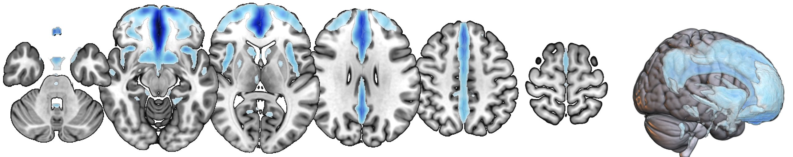
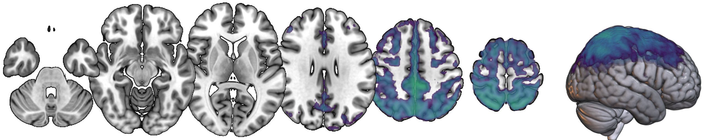
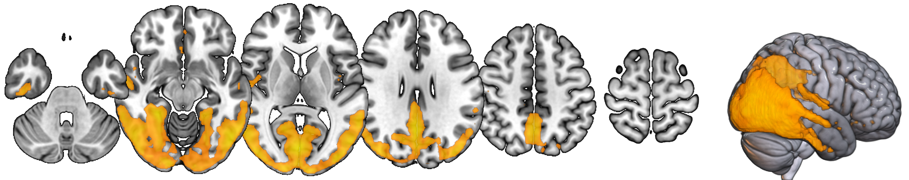

# Components

Cortical amyloid-β PET components derived by probabilistic independent component analysis (ICA) in the AMYPAD Prognostic & Natural History Study. All maps are in MNI152NLin6Asym space at 2 mm resolution.

## File types

Each component is provided in three versions:

- `desc-probmap`: component probability map (Mixture Modeling, FSL MELODIC)
- `desc-zstat`: unthresholded Z-statistic map
- `desc-zstatmasked`: Z-statistic map thresholded at 80% component probability; used by `apply_components.py`

## Frontal component

<Prefrontal, comprising medial and lateral prefrontal, cingulate and precuneus regions>

Files:

- `atlas-AmyloidICA_space-MNI152NLin6Asym_res-2_label-frontal_desc-probmap_probseg.nii.gz`
- `atlas-AmyloidICA_space-MNI152NLin6Asym_res-2_label-frontal_desc-zstat_statmap.nii.gz`
- `atlas-AmyloidICA_space-MNI152NLin6Asym_res-2_label-frontal_desc-zstatmasked_statmap.nii.gz`

## Parietal component

<Superior lateral parietal, precuneus and postcentral>

Files:

- `atlas-AmyloidICA_space-MNI152NLin6Asym_res-2_label-parietal_desc-probmap_probseg.nii.gz`
- `atlas-AmyloidICA_space-MNI152NLin6Asym_res-2_label-parietal_desc-zstat_statmap.nii.gz`
- `atlas-AmyloidICA_space-MNI152NLin6Asym_res-2_label-parietal_desc-zstatmasked_statmap.nii.gz`

## Occipital component

<Fusiform, inferior temporal, lingual, middle temporal, lateral occipital, occipital pole, supracalcarine and intracalcarine>

Files:

- `atlas-AmyloidICA_space-MNI152NLin6Asym_res-2_label-occipital_desc-probmap_probseg.nii.gz`
- `atlas-AmyloidICA_space-MNI152NLin6Asym_res-2_label-occipital_desc-zstat_statmap.nii.gz`
- `atlas-AmyloidICA_space-MNI152NLin6Asym_res-2_label-occipital_desc-zstatmasked_statmap.nii.gz`

## Usage

To quantify these components in a new PET scan, see `apply_components.py` and the instructions in the main [README](../README.md). Please cite: _TO BE UPDATED_.